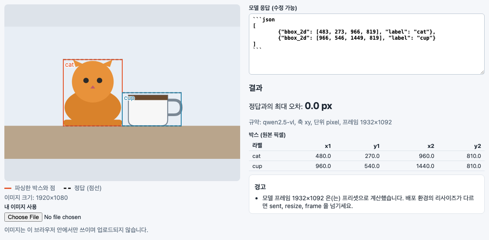
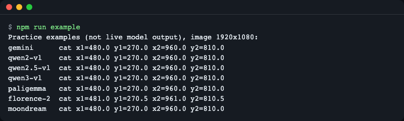
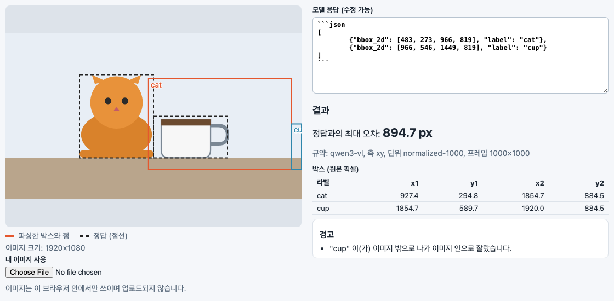
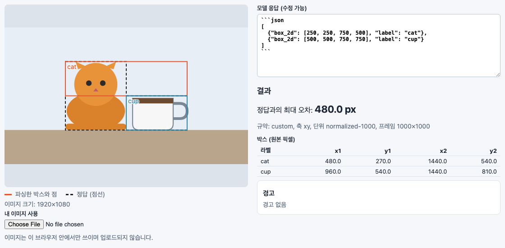
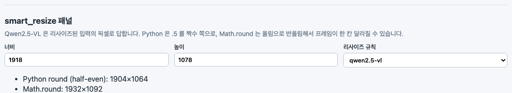
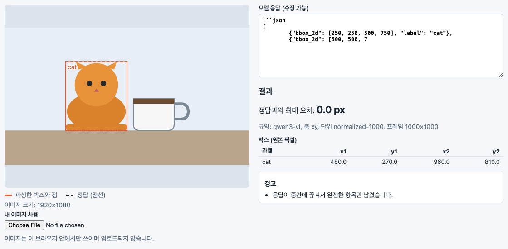

[English](README.md) | **한국어**

# vlmbox

비전 언어 모델이 돌려준 물체 박스와 점을 원본 이미지의 픽셀 좌표로 바꾸고, 화면의 올바른 위치에 그려 줍니다. `parseGrounding(text, { model, image })` 한 번으로 Gemini, Qwen2-VL, Qwen2.5-VL, Qwen3-VL, PaliGemma, Florence-2, Moondream 응답을 처리합니다. 런타임 의존성이 없고 Node와 브라우저에서 모두 동작하며, 작은 React 컴포넌트가 어떤 `object-fit` 에서도 결과를 올바르게 그립니다.



*연습용 예시를 담은 데모 화면. 실선 박스는 vlmbox가 파싱한 결과, 점선 박스는 알고 있는 정답입니다. 둘이 겹쳐서 최대 오차가 0.0 px 입니다.*

## 왜 필요한가

주소를 떠올려 보세요. 어떤 나라는 시·구·동 순서로 쓰고 어떤 나라는 동·구·시 순서로 씁니다. 어느 순서인지 알아야 지도 핀이 제 위치에 꽂힙니다.

비전 언어 모델의 좌표도 마찬가지입니다. 같은 1920x1080 이미지에서 "고양이"를 찾아 달라고 하면 모델마다 숫자가 다르게 나오고, 각자의 규약으로는 모두 맞는 값입니다.

| 모델 | 고양이에 대해 돌려주는 값 |
|---|---|
| Gemini | `[250, 250, 750, 500]` (y 먼저, 0-1000) |
| Qwen2.5-VL | `[483, 273, 966, 819]` (x 먼저, 리사이즈된 입력의 픽셀) |
| Qwen3-VL | `[250, 250, 500, 750]` (x 먼저, 0-1000) |
| PaliGemma | `<loc0256><loc0256><loc0768><loc0512>` (y 먼저, 1024칸) |
| Moondream | `{"x_min": 0.25, "y_min": 0.25, "x_max": 0.5, "y_max": 0.75}` (0-1 비율) |

모두 원본 이미지의 같은 박스(x 480-960, y 270-810)를 뜻합니다. 다른 모델의 규칙으로 읽으면 박스가 엉뚱한 곳에 놓입니다([잡아 주는 흔한 실수](#잡아-주는-흔한-실수) 참고). vlmbox는 Qwen2.5-VL의 리사이즈 단계까지 포함해 알맞은 규칙을 적용하고, 추측하거나 고친 부분은 경고로 알려 줍니다.

위 표의 값은 `fixtures/` 의 연습용 예시에서 가져왔습니다([예시 응답은 어떻게 만들었나](#예시-응답은-어떻게-만들었나) 참고).

## 지원 모델

2026-11-13 확인. 모든 규약은 한 식으로 원본 픽셀이 됩니다: `픽셀 = (값 + bin) * 이미지 크기 / 프레임 크기`.

| `model` | 출력 모양 | 축 순서 | 단위 | 기준 프레임 | 출처 |
|---|---|---|---|---|---|
| `gemini` | JSON `box_2d` (`{"boxes": [...]}` 래핑도 처리) | y 먼저 | 0-1000 | 이미지 전체 | [Vertex AI bounding box detection](https://docs.cloud.google.com/vertex-ai/generative-ai/docs/bounding-box-detection), [Gemini image understanding](https://aistudio.google.com/docs/image-understanding) |
| `qwen2-vl` | `<\|box_start\|>(x1,y1),(x2,y2)<\|box_end\|>` | x 먼저 | 0-1000 | 이미지 전체 | Qwen2-VL 박스 토큰 |
| `qwen2.5-vl` | JSON `bbox_2d`, `point_2d` | x 먼저 | 절대 픽셀 | 리사이즈된 입력(`smart_resize`, factor 28) | [Qwen3-VL 쿡북 2d_grounding](https://github.com/QwenLM/Qwen3-VL/blob/main/cookbooks/2d_grounding.ipynb), [qwen-vl-utils](https://github.com/QwenLM/Qwen3-VL/blob/main/qwen-vl-utils/src/qwen_vl_utils/vision_process.py) |
| `qwen3-vl` | JSON `bbox_2d`, `point_2d` | x 먼저 | 0-1000 | 이미지 전체 | [Qwen3-VL 쿡북 2d_grounding](https://github.com/QwenLM/Qwen3-VL/blob/main/cookbooks/2d_grounding.ipynb) |
| `paligemma` | `<locYYYY><locXXXX><locYYYY><locXXXX> label ; ...` | y 먼저 | 0-1023 토큰, 1024로 나눔 | 이미지 전체 | [big_vision PaliGemma README](https://github.com/google-research/big_vision/blob/main/big_vision/configs/proj/paligemma/README.md) |
| `florence-2` | `label<loc_x1><loc_y1><loc_x2><loc_y2>` | x 먼저 | 1000칸, 칸 중앙(+0.5) | 이미지 전체 | [processing_florence2.py](https://huggingface.co/microsoft/Florence-2-large/blob/main/processing_florence2.py) |
| `moondream` | JSON `objects[]` 의 `x_min..y_max`, 점은 `{x, y}` | x 먼저 | 0-1 비율 | 이미지 전체 | [Moondream detect](https://moondream.ai/c/docs/advanced/api/detect), [point](https://moondream.ai/c/docs/advanced/api/point) |
| 사용자 정의 객체 | `box_2d`, `bbox_2d`, `bbox`, `box`, `point_2d`, `point` 중 하나가 든 JSON | `axis: 'xy' \| 'yx'` | `unit: 'pixel' \| 'normalized'` + `scale`, 선택 `binCenter` | `frame` 또는 이미지 | 직접 지정 |
| `'auto'` | 위 중 아무거나 | 추정 | 추정 | 추정 | [API](#api) 참고 |

Qwen의 규약은 세대마다 바뀌었습니다. Qwen2-VL은 0-1000, Qwen2.5-VL은 절대 픽셀, Qwen3-VL은 다시 0-1000입니다. 실제로 답한 모델을 지정하세요.

## 설치

```bash
npm install vlmbox
```

Node 20 이상(또는 최신 브라우저)이 필요합니다. React는 선택이며 `vlmbox/react` 를 쓸 때만 필요합니다(`npm install react`).

소스에서 먼저 써 보려면:

```bash
git clone https://github.com/LeeGyeongPil/vlmbox.git
cd vlmbox
npm install
npm run example
```

## 빠른 시작

Gemini는 `box_2d` 를 `[ymin, xmin, ymax, xmax]`, 0-1000 단위로 답하며 보통 코드 펜스 안에 담습니다.

```js
import { parseGrounding } from 'vlmbox';

const image = { width: 1920, height: 1080 }; // 원본 이미지 크기
const text = '```json\n[{"box_2d": [250, 250, 750, 500], "label": "cat"}]\n```';

const result = parseGrounding(text, { model: 'gemini', image });
console.log(result.boxes);
```

```
[ { label: 'cat', x1: 480, y1: 270, x2: 960, y2: 810 } ]
```

Qwen2.5-VL은 모델 쪽에서 리사이즈한 이미지의 절대 픽셀로 답합니다. vlmbox가 그 크기를 (파이썬 기준과 같은 반올림으로) 계산해 주고 결과에 알려 줍니다.

```js
const qwen = '[{"bbox_2d": [483, 273, 966, 819], "label": "cat"}]';
const r = parseGrounding(qwen, { model: 'qwen2.5-vl', image });
console.log(r.boxes[0], r.convention.frame, r.warnings.map((w) => w.code));
```

```
{ label: 'cat', x1: 480, y1: 270, x2: 960, y2: 810 } { width: 1932, height: 1092 } [ 'frame-from-preset' ]
```

`frame-from-preset` 경고는 프레임을 받은 것이 아니라 계산했다는 뜻입니다. 서버가 다르게 리사이즈한다면 [그래도 박스가 어긋날 때](#그래도-박스가-어긋날-때)를 보세요.

같이 들어 있는 예제를 실행하면 모델별 연습용 응답 하나씩을 같은 픽셀로 되돌립니다.

```bash
npm run example
```

```
Practice examples (not live model output), image 1920x1080:
gemini      cat x1=480.0 y1=270.0 x2=960.0 y2=810.0
qwen2-vl    cat x1=480.0 y1=270.0 x2=960.0 y2=810.0
qwen2.5-vl  cat x1=480.0 y1=270.0 x2=960.0 y2=810.0
qwen3-vl    cat x1=480.0 y1=270.0 x2=960.0 y2=810.0
paligemma   cat x1=480.0 y1=270.0 x2=960.0 y2=810.0
florence-2  cat x1=481.0 y1=270.5 x2=961.0 y2=810.5
moondream   cat x1=480.0 y1=270.0 x2=960.0 y2=810.0
```



*서로 다른 일곱 가지 응답 형식이 하나의 원본 픽셀 좌표로 모입니다. Florence-2만 0.5픽셀 어긋나는데, 위치를 1000칸으로 저장하기 때문에 vlmbox가 칸 중앙으로 복원하기 때문입니다.*

## React 오버레이

`GroundingOverlay` 는 `` 위에 SVG 레이어로 박스를 그립니다. `object-fit`(레터박스, 잘림)과 레이아웃 크기 변화를 따라가서 박스가 물체 위에 그대로 있습니다.

```tsx
import { parseGrounding } from 'vlmbox';
import { GroundingOverlay } from 'vlmbox/react';

const result = parseGrounding(text, { model: 'gemini', image: { width: 1920, height: 1080 } });

export function Photo() {
  return (
    <GroundingOverlay
      src="/photo.jpg"
      result={result}
      fit="contain"
      onBoxClick={(box) => console.log(box.label)}
    />
  );
}
```

속성: `src`, `result`, `alt`, `fit`(`contain`, `cover`, `fill`, `none`, `scale-down`), `showLabels`, `showPoints`, `colors`, `className`, `style`, `onBoxClick`, `referenceBoxes`(점선 윤곽, 예: 정답), `imageSize`(미리 아는 원본 크기). 이미지 자체에는 테두리를 주지 마세요. 테두리가 내용 영역을 밀어냅니다.

React 없이 쓰려면 `toDisplay(box, natural, rendered, fit)` 로 박스를 이미지를 보여 주는 요소 안의 좌표로 바꿉니다.

```js
import { toDisplay } from 'vlmbox';

toDisplay(result.boxes[0], { width: 1920, height: 1080 }, { width: 960, height: 960 }, 'contain');
// { label: 'cat', x1: 240, y1: 345, x2: 480, y2: 615 }
```

## 데모 페이지

같은 응답이 규칙에 따라 이미지 위 어디에 놓이는지 보여 주는 작은 페이지가 저장소에 들어 있습니다. 키가 필요 없고 모델도 호출하지 않습니다. clone 한 폴더에서 실행합니다.

```bash
npm install
npm run demo
```

Vite가 출력하는 주소를 엽니다. 예시 응답을 고르고 **다음 규약으로 읽기** 를 바꾸면 박스가 움직이는 것을 볼 수 있습니다. 페이지는 알고 있는 정답과의 최대 오차, 쓰인 규약, 경고를 보여 줍니다. 직접 붙여 넣은 응답과 내 이미지(이미지는 브라우저 밖으로 나가지 않습니다)도 쓸 수 있습니다.

**화면 언어.** 오른쪽 위의 English / 한국어 메뉴로 바꿉니다. 선택은 브라우저에 저장되고(`localStorage` 키 `vlmbox.demo.lang`) 새로고침해도 유지됩니다. 저장된 값이 없는 첫 방문에만 브라우저 언어가 정합니다(`ko*` 이면 한국어, 아니면 영어). 스크린샷이나 링크에서는 주소에 `?lang=en` 또는 `?lang=ko` 를 붙여 언어를 고정할 수 있습니다. 시작 상태도 주소로 정할 수 있습니다: `?example=<id>&readAs=<model>&fit=contain|cover|fill` (예: `?example=qwen2.5-vl&readAs=qwen3-vl`, 알 수 없는 값은 무시). 이 README의 스크린샷은 한국어 화면이고, [README.md](README.md)는 영어 화면을 씁니다.



*첫 그림과 같은 응답을 Qwen3-VL의 규칙으로 읽었습니다. 최대 오차가 894.7 px 로 뛰어오릅니다.*

## API

모든 내보내기는 `vlmbox` 에서 오고, React 컴포넌트는 `vlmbox/react` 에서 옵니다.

**`parseGrounding(text, options): GroundingResult`**

| 옵션 | 뜻 |
|---|---|
| `model` | `'gemini'`, `'qwen2-vl'`, `'qwen2.5-vl'`, `'qwen3-vl'`, `'paligemma'`, `'florence-2'`, `'moondream'`, `'auto'`, 또는 사용자 정의 규약 객체 `{ axis, unit, scale?, binCenter?, frame? }` |
| `image` | 원본 이미지 크기 `{ width, height }`. 결과는 이 이미지의 픽셀입니다 |
| `sent` | 이미지를 먼저 줄여서 보냈다면 실제로 보낸 크기 |
| `resize` | Qwen2.5-VL 프레임을 계산하는 규칙: `'qwen2.5-vl'`(기본), `'qwen2-vl-processor-default'`, `'qwen3-vl'`, 또는 `{ factor, minPixels, maxPixels }` |
| `frame` | 모델이 본 프레임을 직접 지정. 가장 우선합니다 |
| `label` | 라벨이 없는 응답(Moondream)에 붙일 라벨 |
| `clamp` | 결과를 이미지 안으로 자르기(기본 `true`) |

`text` 는 이미 파싱된 객체여도 됩니다. 결과는 `{ boxes, points, warnings, convention }` 입니다. 박스는 `{ label, x1, y1, x2, y2 }`, 점은 `{ label, x, y }` 이고 모두 원본 픽셀이며 모델이 쓴 순서를 유지합니다. `convention` 은 무엇을 썼는지 알려 줍니다: `id`, `axis`, `unit`, `frame`, `guessed`, 그리고 `'auto'` 일 때 `confidence`, `reason`.

경고(`warnings[].code`): `truncated-json`, `clamped`, `swapped-corners`, `guessed-convention`, `frame-from-preset`, `no-grounding-found`, `skipped-item`. 위치 정보가 전혀 없는 텍스트는 예외를 던지지 않고 `no-grounding-found` 경고가 붙은 빈 결과를 돌려줍니다.

```js
const cut = '[{"bbox_2d": [250, 250, 500, 750], "label": "cat"}, {"bbox_2d": [500, 5';
const t = parseGrounding(cut, { model: 'qwen3-vl', image });
console.log(t.boxes.length, t.warnings.map((w) => w.code));
```

```
1 [ 'truncated-json' ]
```

코드 펜스, JSON 앞뒤의 설명문, 최대 토큰에서 끊긴 응답을 처리하며 완전한 항목은 살립니다.

`model: 'auto'` 는 먼저 키 이름과 토큰을 봅니다(확신도 `high`). `bbox_2d` 값만 있을 때는 값 범위밖에 볼 수 없고, 0-1000 범위는 Qwen3-VL일 수도 Qwen2.5-VL 픽셀일 수도 있어서 이 추정의 확신도는 항상 `low` 입니다.

```js
const d = parseGrounding(qwen, { model: 'auto', image });
console.log(d.convention.id, d.convention.guessed, d.convention.confidence, d.warnings.map((w) => w.code));
```

```
qwen3-vl true low [ 'guessed-convention' ]
```

모델을 알고 있다면 항상 직접 지정하세요.

**`smartResize(size, rule): Size`** 는 Qwen의 이미지 리사이즈(두 변이 `factor` 의 배수가 되고 픽셀 수가 `[minPixels, maxPixels]` 안에 들어감)를 파이썬과 같은 반올림(반올림 시 짝수 쪽, half to even)으로 재현합니다. `rule` 은 프리셋 이름이나 `{ factor, minPixels, maxPixels, rounding? }` 입니다. `rounding: 'half-up'` 은 비교용으로 `Math.round` 를 흉내 냅니다. 프리셋 목록은 `RESIZE_PRESETS` 에 있습니다.

```js
import { smartResize } from 'vlmbox';

smartResize({ width: 1920, height: 1080 }, 'qwen2.5-vl');                  // { width: 1932, height: 1092 }
smartResize({ width: 1920, height: 1080 }, 'qwen2-vl-processor-default');  // { width: 1316, height: 728 }
smartResize({ width: 1918, height: 1078 }, 'qwen2.5-vl');                  // { width: 1904, height: 1064 }
```

가로세로 비율이 200을 넘으면 `ASPECT_RATIO_TOO_LARGE` 를 던집니다.

**`guessConvention(values, image)`** 는 원시 숫자에 대해 `{ guess, confidence, reason }` 을 돌려줍니다. **`toDisplay(item, natural, rendered, fit)`** 는 박스나 점을 화면 좌표로 바꿉니다. **`toXYWH(box)`** 는 `{ label, x, y, width, height }` 를 돌려줍니다.

**`VlmboxError`** 에는 `code` 가 있습니다: `INVALID_IMAGE_SIZE`, `UNKNOWN_MODEL`, `INVALID_CONVENTION`, `ASPECT_RATIO_TOO_LARGE`. 라이브러리의 오류·경고 메시지는 영어이므로 화면에 보일 문구는 `code` 로 직접 정하세요.

```js
import { parseGrounding, VlmboxError } from 'vlmbox';

try {
  parseGrounding('x', { model: 'nope', image });
} catch (err) {
  console.log(err instanceof VlmboxError, err.code);
}
```

```
true UNKNOWN_MODEL
```

Moondream 응답에는 라벨이 없으니 직접 넘기세요.

```js
const md = '{"objects":[{"x_min":0.25,"y_min":0.25,"x_max":0.5,"y_max":0.75}]}';
parseGrounding(md, { model: 'moondream', image, label: 'cat' }).boxes;
// [ { label: 'cat', x1: 480, y1: 270, x2: 960, y2: 810 } ]
```

## 잡아 주는 흔한 실수

아래는 어림짐작이 아니라 연습용 예시를 실제로 변환한 값입니다. 테스트와 데모 페이지에서 그대로 재현됩니다.

| 실수 | 1920x1080 예시의 최대 오차 |
|---|---|
| Qwen2.5-VL 응답을 Qwen3-VL로 읽기(픽셀 대신 0-1000으로) | 894.7 px |
| Gemini의 y 먼저 `box_2d` 를 x 먼저로 읽기 | 480 px |
| Qwen2.5-VL 프레임을 원본 이미지로 착각하기 | 9 px |
| 리사이즈 반올림을 파이썬 규칙 대신 `Math.round` 로 하기 | 일부 크기에서 프레임이 28 px 한 칸 달라짐 |



*y 먼저 응답을 x 먼저로 읽으면 박스가 대각선을 기준으로 뒤집힙니다.*

반올림 문제는 눈에 잘 안 띕니다. 파이썬의 `round` 는 .5를 짝수 쪽으로, 자바스크립트의 `Math.round` 는 위로 올립니다. 1918x1078 이미지는 Qwen2.5-VL 규칙으로 파이썬에서 1904x1064, `Math.round` 로는 1932x1092 가 됩니다. 70,686개 크기를 비교했을 때 half-even 구현은 파이썬 기준과 불일치가 없었고, `Math.round` 구현은 1,375개 크기에서 달랐습니다. vlmbox는 그 기준표를 테스트로 함께 제공합니다.



*데모 페이지의 smart_resize 패널. 한쪽은 짝수 쪽 반올림, 다른 쪽은 올림이라 프레임이 한 칸 달라집니다.*

그 밖의 보정도 경고로 알려 줍니다. 이미지를 살짝 벗어난 값은 잘라 내고(`clamped`), 모서리가 거꾸로 온 박스는 바로잡고(`swapped-corners`), 박스가 아닌 항목은 건너뛰고(`skipped-item`), 잘린 JSON은 완전한 항목만 살립니다(`truncated-json`).



*최대 토큰에서 끊긴 응답도 완전한 첫 번째 박스는 경고와 함께 살려 냅니다.*

## 그래도 박스가 어긋날 때

규약이 맞는데도 박스가 밀린다면 원인은 보통 변환 바깥에 있습니다.

- **서버가 이미지를 다르게 리사이즈한 경우(Qwen2.5-VL).** 프리셋은 qwen-vl-utils 기본값을 가정합니다. 설정이 다르면 프레임도 다릅니다. 1920x1080 에 `qwen2-vl-processor-default` 규칙을 쓰면 1316x728 입니다. 맞는 `resize` 를 고르거나 프레임을 직접 지정하세요.
- **이미지를 줄여서 보낸 경우.** 보낸 크기는 `sent`, 원본은 `image` 로 넘깁니다.
- **정확한 프레임을 아는 경우.** `frame: { width, height }` 를 넘기면 다른 모든 것보다 우선합니다.
- **모델 id가 틀린 경우.** Qwen3-VL 답을 `qwen2.5-vl` 로 읽거나 그 반대면 박스가 크게 밀립니다. `result.convention` 을 확인하세요.
- **서빙 환경.** Qwen3-VL을 일부 서빙 설정으로 띄웠을 때 0-1000 좌표가 어긋난 사례가 있습니다([QwenLM/Qwen3-VL#1871](https://github.com/QwenLM/Qwen3-VL/issues/1871)). 클라이언트의 변환으로는 고칠 수 없습니다.

| 상황 | 옵션 |
|---|---|
| qwen-vl-utils 기본 동작 | 없음(`resize: 'qwen2.5-vl'`) |
| transformers `Qwen2VLImageProcessor` 클래스 기본값 | `resize: 'qwen2-vl-processor-default'` |
| 직접 정한 `min_pixels` / `max_pixels` | `resize: { factor: 28, minPixels, maxPixels }` |
| 직접 이미지를 줄여서 보냄 | `sent: { width, height }` |
| 정확한 프레임을 앎 | `frame: { width, height }` |

실제 응답이 제대로 읽히지 않으면 응답 텍스트와 이미지 크기를 적어 이슈를 열어 주세요.

## 예시 응답은 어떻게 만들었나

`fixtures/responses/` 의 응답은 **실제 모델 출력이 아닙니다.** 각 모델의 공개 문서가 설명하는 출력 형식대로 손으로 썼고, 알고 있는 장면 하나(1920x1080 이미지에서 고양이는 x 480-960, y 270-810, 컵은 x 960-1440, y 540-810)에서 거꾸로 계산했습니다. 테스트, 예제 스크립트, 데모 페이지에 쓰는 연습용 예시입니다. 실제 출력은 키가 더 붙거나 문구·공백이 다를 수 있습니다. 각 예시가 따르는 문서는 `fixtures/README.md` 에 있습니다.

그래서 API 키도 필요 없습니다. 어디서도 모델을 호출하지 않습니다.

## 개발

```bash
npm install
npm test             # 단위 테스트 (키·네트워크 불필요)
npm run typecheck
npm run example      # 빌드 후 examples/basic.mjs 실행
npm run demo         # 핫 리로드 데모 페이지
npm run demo:build   # 데모 페이지 정적 빌드(demo-dist/)
python3 -I scripts/gen-smart-resize-ref.py   # smart_resize 기준표 다시 만들기
```

`npm run build` 는 `dist/`(ES 모듈과 타입 선언)를 만듭니다. 코어 진입점은 React를 import 하지 않습니다.

## 라이선스

MIT, [LICENSE](LICENSE) 참고. 변경 내역은 [CHANGELOG.md](CHANGELOG.md) 에 있습니다.
