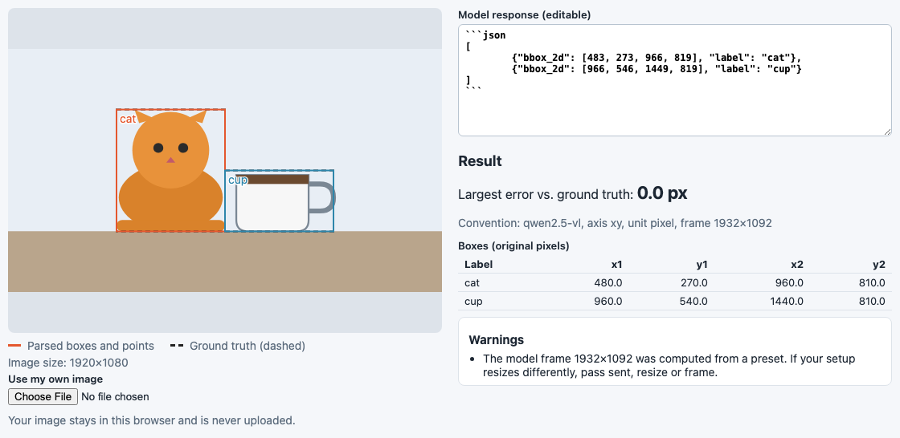
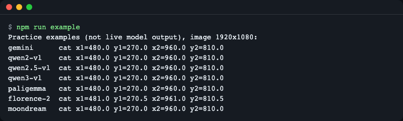
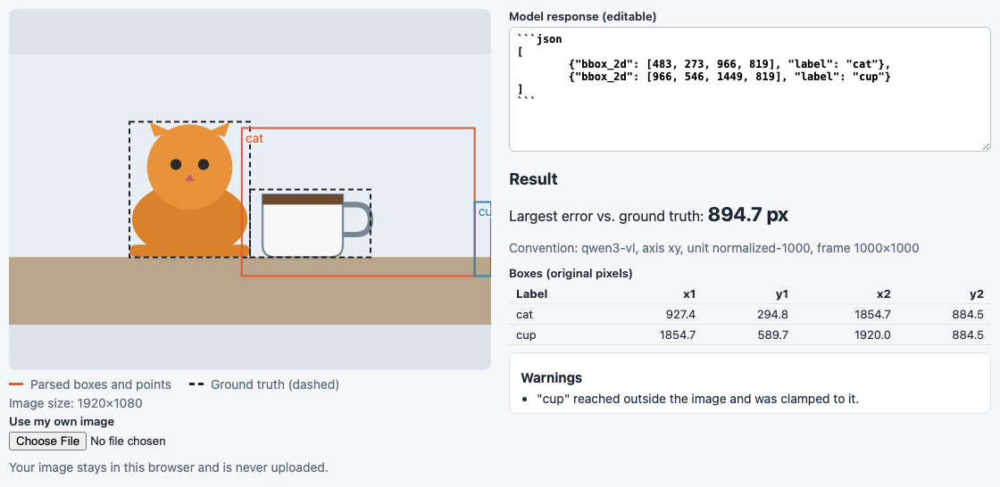
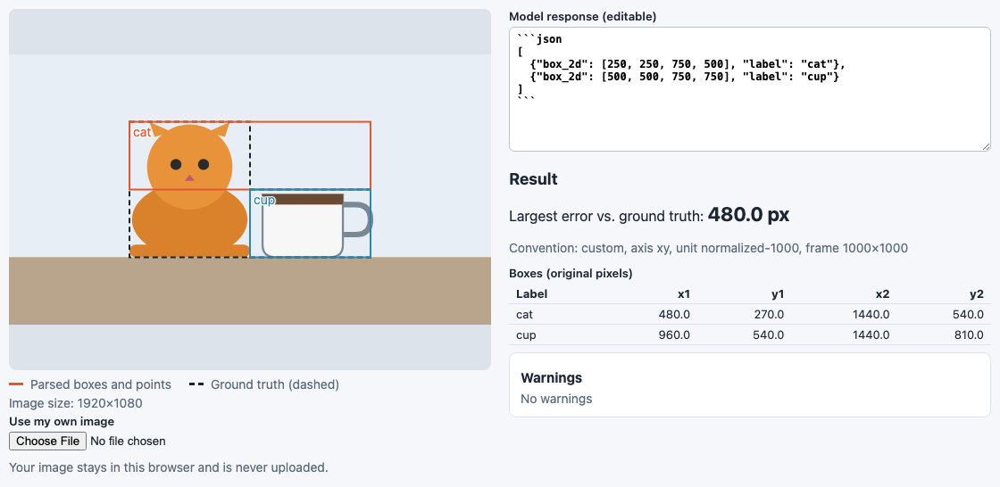
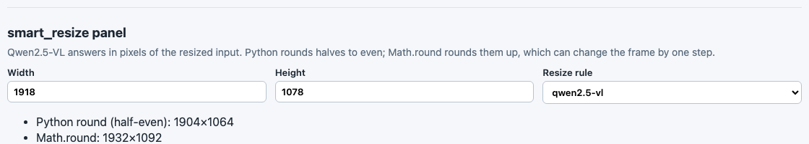
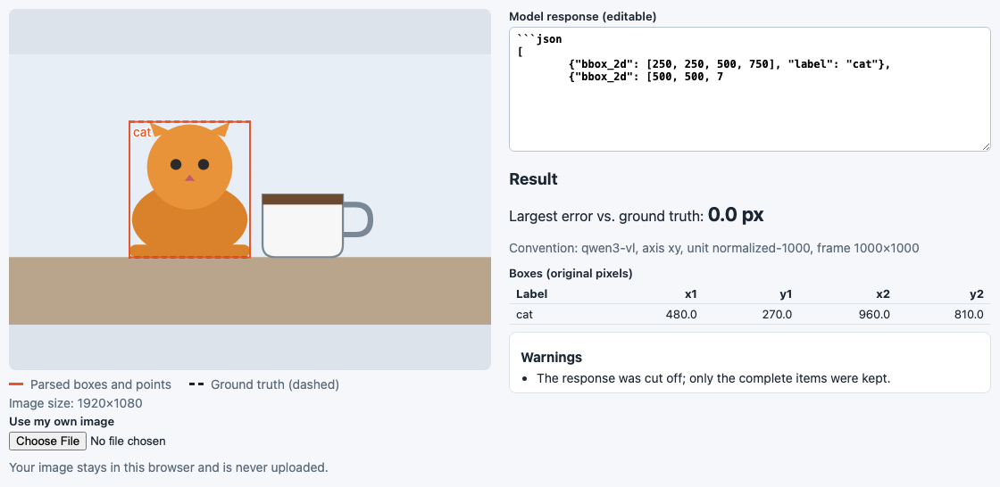

**English** | [한국어](README.ko.md)

# vlmbox

Turn the object boxes and points that vision-language models return into pixel coordinates on your original image, and draw them in the right place. One call, `parseGrounding(text, { model, image })`, handles Gemini, Qwen2-VL, Qwen2.5-VL, Qwen3-VL, PaliGemma, Florence-2 and Moondream. Zero runtime dependencies; runs in Node and in the browser, and a small React component draws the result under any `object-fit`.



*The demo page with a practice example. Solid boxes are what vlmbox parsed, dashed boxes are the known truth. They coincide, so the largest error is 0.0 px.*

## Why

Think of an address. Some countries write city, district, street; others write street, district, city. A map pin only lands in the right spot if you know which order was used.

Vision-language models do the same with coordinates. Ask several of them for "the cat" in the same 1920x1080 image and you get different numbers, all correct in their own convention:

| Model | What it returns for the cat |
|---|---|
| Gemini | `[250, 250, 750, 500]` (y first, 0-1000) |
| Qwen2.5-VL | `[483, 273, 966, 819]` (x first, pixels of the resized input) |
| Qwen3-VL | `[250, 250, 500, 750]` (x first, 0-1000) |
| PaliGemma | `<loc0256><loc0256><loc0768><loc0512>` (y first, 1024 bins) |
| Moondream | `{"x_min": 0.25, "y_min": 0.25, "x_max": 0.5, "y_max": 0.75}` (0-1 fractions) |

All of these mean the same box: x 480-960, y 270-810 in the original image. Reading one with another model's rule puts the box in the wrong place (see [Common mistakes it catches](#common-mistakes-it-catches)). vlmbox applies the right rule, including the Qwen2.5-VL resize step, and tells you when it had to guess or repair something.

The rows above come from the practice examples in `fixtures/` (see [How the examples were made](#how-the-examples-were-made)).

## Supported models

Checked on 2026-11-13. Every convention is turned into original-image pixels with one formula: `pixel = (value + bin) * image size / frame size`.

| `model` | Output shape | Axis order | Unit | Reference frame | Source |
|---|---|---|---|---|---|
| `gemini` | JSON `box_2d` (also `{"boxes": [...]}`) | y first | 0-1000 | whole image | [Vertex AI bounding box detection](https://docs.cloud.google.com/vertex-ai/generative-ai/docs/bounding-box-detection), [Gemini image understanding](https://aistudio.google.com/docs/image-understanding) |
| `qwen2-vl` | `<\|box_start\|>(x1,y1),(x2,y2)<\|box_end\|>` | x first | 0-1000 | whole image | Qwen2-VL box tokens |
| `qwen2.5-vl` | JSON `bbox_2d`, `point_2d` | x first | absolute pixels | the resized input (`smart_resize`, factor 28) | [Qwen3-VL cookbook, 2d_grounding](https://github.com/QwenLM/Qwen3-VL/blob/main/cookbooks/2d_grounding.ipynb), [qwen-vl-utils](https://github.com/QwenLM/Qwen3-VL/blob/main/qwen-vl-utils/src/qwen_vl_utils/vision_process.py) |
| `qwen3-vl` | JSON `bbox_2d`, `point_2d` | x first | 0-1000 | whole image | [Qwen3-VL cookbook, 2d_grounding](https://github.com/QwenLM/Qwen3-VL/blob/main/cookbooks/2d_grounding.ipynb) |
| `paligemma` | `<locYYYY><locXXXX><locYYYY><locXXXX> label ; ...` | y first | 0-1023 tokens, divided by 1024 | whole image | [big_vision PaliGemma README](https://github.com/google-research/big_vision/blob/main/big_vision/configs/proj/paligemma/README.md) |
| `florence-2` | `label<loc_x1><loc_y1><loc_x2><loc_y2>` | x first | 1000 bins, bin centre (+0.5) | whole image | [processing_florence2.py](https://huggingface.co/microsoft/Florence-2-large/blob/main/processing_florence2.py) |
| `moondream` | JSON `objects[]` with `x_min..y_max`, points as `{x, y}` | x first | 0-1 fractions | whole image | [Moondream detect](https://moondream.ai/c/docs/advanced/api/detect), [point](https://moondream.ai/c/docs/advanced/api/point) |
| custom object | JSON with `box_2d`, `bbox_2d`, `bbox`, `box`, `point_2d` or `point` | `axis: 'xy' \| 'yx'` | `unit: 'pixel' \| 'normalized'` + `scale`, optional `binCenter` | `frame` or the image | your own setup |
| `'auto'` | any of the above | guessed | guessed | guessed | see [API](#api) |

Qwen's convention changed between generations: Qwen2-VL used 0-1000, Qwen2.5-VL used absolute pixels, Qwen3-VL went back to 0-1000. Pass the model that actually answered.

## Install

```bash
npm install vlmbox
```

Needs Node 20 or newer (or any modern browser). React is optional and only needed for `vlmbox/react` (`npm install react`).

To try it from source instead:

```bash
git clone https://github.com/LeeGyeongPil/vlmbox.git
cd vlmbox
npm install
npm run example
```

## Quick start

Gemini answers with `box_2d` as `[ymin, xmin, ymax, xmax]` on a 0-1000 scale, usually inside a code fence:

```js
import { parseGrounding } from 'vlmbox';

const image = { width: 1920, height: 1080 }; // the ORIGINAL image size
const text = '```json\n[{"box_2d": [250, 250, 750, 500], "label": "cat"}]\n```';

const result = parseGrounding(text, { model: 'gemini', image });
console.log(result.boxes);
```

```
[ { label: 'cat', x1: 480, y1: 270, x2: 960, y2: 810 } ]
```

Qwen2.5-VL answers in absolute pixels of the image *after its own resize*. vlmbox computes that size for you (with the same rounding as the Python reference) and reports it:

```js
const qwen = '[{"bbox_2d": [483, 273, 966, 819], "label": "cat"}]';
const r = parseGrounding(qwen, { model: 'qwen2.5-vl', image });
console.log(r.boxes[0], r.convention.frame, r.warnings.map((w) => w.code));
```

```
{ label: 'cat', x1: 480, y1: 270, x2: 960, y2: 810 } { width: 1932, height: 1092 } [ 'frame-from-preset' ]
```

The `frame-from-preset` warning means the frame was computed, not given. If your server resizes differently, see [When boxes are still off](#when-boxes-are-still-off).

Run the bundled example, which maps one practice response per model back to the same pixels:

```bash
npm run example
```

```
Practice examples (not live model output), image 1920x1080:
gemini      cat x1=480.0 y1=270.0 x2=960.0 y2=810.0
qwen2-vl    cat x1=480.0 y1=270.0 x2=960.0 y2=810.0
qwen2.5-vl  cat x1=480.0 y1=270.0 x2=960.0 y2=810.0
qwen3-vl    cat x1=480.0 y1=270.0 x2=960.0 y2=810.0
paligemma   cat x1=480.0 y1=270.0 x2=960.0 y2=810.0
florence-2  cat x1=481.0 y1=270.5 x2=961.0 y2=810.5
moondream   cat x1=480.0 y1=270.0 x2=960.0 y2=810.0
```



*Seven different response formats, one set of original-image pixels. Florence-2 differs by half a pixel because it stores positions in 1000 bins and vlmbox restores each bin to its centre.*

## React overlay

`GroundingOverlay` draws the boxes as an SVG layer over an ``. It follows `object-fit` (letterboxing and cropping) and layout resizes, so boxes stay on the objects.

```tsx
import { parseGrounding } from 'vlmbox';
import { GroundingOverlay } from 'vlmbox/react';

const result = parseGrounding(text, { model: 'gemini', image: { width: 1920, height: 1080 } });

export function Photo() {
  return (
    <GroundingOverlay
      src="/photo.jpg"
      result={result}
      fit="contain"
      onBoxClick={(box) => console.log(box.label)}
    />
  );
}
```

Props: `src`, `result`, `alt`, `fit` (`contain`, `cover`, `fill`, `none`, `scale-down`), `showLabels`, `showPoints`, `colors`, `className`, `style`, `onBoxClick`, `referenceBoxes` (dashed outlines, for example ground truth), `imageSize` (natural size, if you know it up front). Do not put a border on the image itself, because a border shifts the content box.

Without React, use `toDisplay(box, natural, rendered, fit)` to map a box into the coordinates of the element that shows the image:

```js
import { toDisplay } from 'vlmbox';

toDisplay(result.boxes[0], { width: 1920, height: 1080 }, { width: 960, height: 960 }, 'contain');
// { label: 'cat', x1: 240, y1: 345, x2: 480, y2: 615 }
```

## Demo page

The repository contains a small page that shows how the same response lands on the image under different rules. It needs no key and calls no model. Run it from a clone:

```bash
npm install
npm run demo
```

Open the address that Vite prints. Pick an example response, change **Read as** to another convention, and watch the boxes move. The page shows the largest error against the known truth, the convention it used, and any warnings. You can also paste your own response and use your own image (the image stays in your browser).

**Language.** The page has an English / 한국어 menu in the top right. The choice is saved in the browser (`localStorage` key `vlmbox.demo.lang`) and restored on reload. Only on the first visit, with nothing saved, the browser language decides: Korean for `ko*`, English otherwise. For screenshots or links you can force a language with `?lang=en` or `?lang=ko` in the address. The starting state can also come from the address: `?example=<id>&readAs=<model>&fit=contain|cover|fill` (for example `?example=qwen2.5-vl&readAs=qwen3-vl`; unknown values are ignored). The screenshots in this README are the English screen; [README.ko.md](README.ko.md) uses the Korean screen.



*Same response as the first picture, read with Qwen3-VL's rule. The largest error jumps to 894.7 px.*

## API

All exports come from `vlmbox`; the React component comes from `vlmbox/react`.

**`parseGrounding(text, options): GroundingResult`**

| Option | Meaning |
|---|---|
| `model` | `'gemini'`, `'qwen2-vl'`, `'qwen2.5-vl'`, `'qwen3-vl'`, `'paligemma'`, `'florence-2'`, `'moondream'`, `'auto'`, or a custom convention object `{ axis, unit, scale?, binCenter?, frame? }` |
| `image` | Original image size `{ width, height }`. Results are in this image's pixels |
| `sent` | Size actually sent to the model, if you shrank the image first |
| `resize` | Rule used to compute the Qwen2.5-VL frame: `'qwen2.5-vl'` (default), `'qwen2-vl-processor-default'`, `'qwen3-vl'`, or `{ factor, minPixels, maxPixels }` |
| `frame` | The frame the model saw, set explicitly. Highest priority |
| `label` | Label for responses that carry none (Moondream) |
| `clamp` | Clamp results to the image (default `true`) |

`text` can also be an already parsed object. The result is `{ boxes, points, warnings, convention }`. Boxes are `{ label, x1, y1, x2, y2 }`, points are `{ label, x, y }`, both in original pixels, in the order the model wrote them. `convention` tells you what was used: `id`, `axis`, `unit`, `frame`, `guessed` and, for `'auto'`, `confidence` and `reason`.

Warnings (`warnings[].code`): `truncated-json`, `clamped`, `swapped-corners`, `guessed-convention`, `frame-from-preset`, `no-grounding-found`, `skipped-item`. Text without any grounding returns an empty result with `no-grounding-found` instead of throwing.

```js
const cut = '[{"bbox_2d": [250, 250, 500, 750], "label": "cat"}, {"bbox_2d": [500, 5';
const t = parseGrounding(cut, { model: 'qwen3-vl', image });
console.log(t.boxes.length, t.warnings.map((w) => w.code));
```

```
1 [ 'truncated-json' ]
```

Code fences, text before and after the JSON, and responses cut off at the token limit are handled; complete items are kept.

`model: 'auto'` looks at key names and tokens first (confidence `high`). When only `bbox_2d` values are available it can only look at their range, and a 0-1000 range could be Qwen3-VL or Qwen2.5-VL pixels, so that guess always has confidence `low`:

```js
const d = parseGrounding(qwen, { model: 'auto', image });
console.log(d.convention.id, d.convention.guessed, d.convention.confidence, d.warnings.map((w) => w.code));
```

```
qwen3-vl true low [ 'guessed-convention' ]
```

Pass the model explicitly whenever you know it.

**`smartResize(size, rule): Size`** reproduces the Qwen image resize (both sides become multiples of `factor`, pixel count within `[minPixels, maxPixels]`) with Python's rounding (half to even). `rule` is a preset name or `{ factor, minPixels, maxPixels, rounding? }`; `rounding: 'half-up'` mimics `Math.round` for comparison. `RESIZE_PRESETS` lists the presets.

```js
import { smartResize } from 'vlmbox';

smartResize({ width: 1920, height: 1080 }, 'qwen2.5-vl');                  // { width: 1932, height: 1092 }
smartResize({ width: 1920, height: 1080 }, 'qwen2-vl-processor-default');  // { width: 1316, height: 728 }
smartResize({ width: 1918, height: 1078 }, 'qwen2.5-vl');                  // { width: 1904, height: 1064 }
```

An aspect ratio above 200 throws `ASPECT_RATIO_TOO_LARGE`.

**`guessConvention(values, image)`** returns `{ guess, confidence, reason }` for raw numbers. **`toDisplay(item, natural, rendered, fit)`** maps a box or point to display coordinates. **`toXYWH(box)`** returns `{ label, x, y, width, height }`.

**`VlmboxError`** has a `code`: `INVALID_IMAGE_SIZE`, `UNKNOWN_MODEL`, `INVALID_CONVENTION`, `ASPECT_RATIO_TOO_LARGE`. Error and warning messages from the library are in English; use the `code` to show your own text.

```js
import { parseGrounding, VlmboxError } from 'vlmbox';

try {
  parseGrounding('x', { model: 'nope', image });
} catch (err) {
  console.log(err instanceof VlmboxError, err.code);
}
```

```
true UNKNOWN_MODEL
```

Moondream responses carry no label, so pass one:

```js
const md = '{"objects":[{"x_min":0.25,"y_min":0.25,"x_max":0.5,"y_max":0.75}]}';
parseGrounding(md, { model: 'moondream', image, label: 'cat' }).boxes;
// [ { label: 'cat', x1: 480, y1: 270, x2: 960, y2: 810 } ]
```

## Common mistakes it catches

These are real conversions of the practice examples, not estimates. Each is reproduced by the test suite and in the demo page.

| Mistake | Largest error on the 1920x1080 example |
|---|---|
| Reading a Qwen2.5-VL response as Qwen3-VL (0-1000 instead of pixels) | 894.7 px |
| Reading Gemini's y-first `box_2d` as x first | 480 px |
| Taking the Qwen2.5-VL frame to be the original image | 9 px |
| Rounding the resize with `Math.round` instead of Python's rule | one 28 px step in the frame for some sizes |



*A y-first answer read as x first: the boxes flip across the diagonal.*

The rounding one is subtle. Python's `round` rounds halves to the even number, JavaScript's `Math.round` rounds them up. For 1918x1078 the Qwen2.5-VL rule gives 1904x1064 in Python and 1932x1092 with `Math.round`. In a comparison over 70,686 sizes, the half-even version had no mismatch with the Python reference, and a `Math.round` version differed on 1,375 sizes. vlmbox ships that reference table as a test.



*The smart_resize panel of the demo page. One side rounds half to even, the other half up, and the frame differs by a step.*

Other repairs, each reported as a warning: values slightly outside the image are clamped (`clamped`), corners given in reverse order are swapped (`swapped-corners`), items that are not boxes are skipped (`skipped-item`), and truncated JSON keeps its complete items (`truncated-json`).



*A response cut off at the token limit still yields the complete first box, with a warning.*

## When boxes are still off

If the convention is right and boxes are still shifted, the cause is usually outside the conversion:

- **Your server resized the image differently (Qwen2.5-VL).** The preset assumes the qwen-vl-utils defaults. Other setups give other frames; for 1920x1080 the `qwen2-vl-processor-default` rule gives 1316x728. Pick the matching `resize`, or set the frame yourself.
- **You shrank the image before sending it.** Pass the sent size as `sent`, and the original as `image`.
- **You know the exact frame.** Pass `frame: { width, height }`; it wins over everything else.
- **Wrong model id.** A Qwen3-VL answer read as `qwen2.5-vl`, or the reverse, shifts boxes by a large amount. Check `result.convention`.
- **The serving stack.** Some serving setups returned shifted 0-1000 coordinates for Qwen3-VL, see [QwenLM/Qwen3-VL#1871](https://github.com/QwenLM/Qwen3-VL/issues/1871). No client-side conversion can fix that.

| Situation | Option |
|---|---|
| Default qwen-vl-utils behaviour | nothing (`resize: 'qwen2.5-vl'`) |
| transformers `Qwen2VLImageProcessor` class defaults | `resize: 'qwen2-vl-processor-default'` |
| Custom `min_pixels` / `max_pixels` | `resize: { factor: 28, minPixels, maxPixels }` |
| You downscaled the image yourself | `sent: { width, height }` |
| You know the exact frame | `frame: { width, height }` |

If a real response is not read correctly, please open an issue with the response text and the image size.

## How the examples were made

The responses in `fixtures/responses/` are **not live model output.** I wrote them by hand in the output format each model's public documentation describes, working backwards from one known scene (a 1920x1080 image with a cat at x 480-960, y 270-810 and a cup at x 960-1440, y 540-810). They are practice examples for tests, the example script and the demo page. Real outputs vary (extra keys, wording, spacing). `fixtures/README.md` lists the documentation each one follows.

That is also why no API key is needed: nothing calls a model.

## Development

```bash
npm install
npm test             # unit tests (no key, no network)
npm run typecheck
npm run example      # build, then run examples/basic.mjs
npm run demo         # demo page with hot reload
npm run demo:build   # static build of the demo page into demo-dist/
python3 -I scripts/gen-smart-resize-ref.py   # regenerate the smart_resize reference table
```

Developing (tests, demo) needs Node 22.22 or newer; using the library needs Node 20 or newer.

`npm run build` writes `dist/` (ES modules and type declarations). The core entry does not import React.

## License

MIT, see [LICENSE](LICENSE). Changes are listed in [CHANGELOG.md](CHANGELOG.md).
